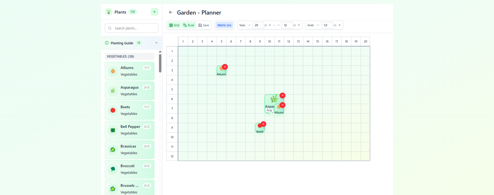

# Projects

A curated collection of projects I've built and contributed to.

[Back to profile](./README.md)

## DK8s

[GitHub](https://github.com/DanielKhojaste/dk8s)

	
	
	
	
	
	
	

An event-driven engineering operations console for registering, monitoring, and managing service lifecycles. DK8s combines Java and Spring Boot services, PostgreSQL, Solace PubSub+, a React operations UI, containers, automated tests, and CI around asynchronous deployment workflows.

## ApotheonAI

[Live site](https://apotheon-ai.vercel.app/) · [GitHub](https://github.com/DanielKhojaste/apotheon-ai)

	
	
	
	
	
	
	

A multi-page AI security website built around reusable frontend components, responsive and accessible UI, structured CMS content, dynamic routes, and browser-based end-to-end testing.

## ToDone for VS Code

[VS Code Marketplace](https://marketplace.visualstudio.com/items?itemName=danielkhojaste.todone-vscode) · [GitHub](https://github.com/DanielKhojaste/ToDone)

	
	

A VS Code extension that brings the ToDone plain-text task workflow to VS Code with priorities, task states, notes, commands, outline support, and Sublime ToDone compatibility.

## PlantPlotter

[Live site](https://www.plantplotter.app/)

	
	
	
	

A stakeholder-driven team project where I worked on data extraction, software quality, deployment, and debugging. We met frequently with the stakeholder to review our progress, discuss feedback, and determine what needed to be done next, while our project manager led the team using a Kanban board.

## Lineup

[GitHub](https://github.com/DanielKhojaste/lineup)

	
	
	
	
	

A tactical board desktop application with interactive drag-and-drop editing and a domain-driven node system designed to make new functionality easier to extend.
