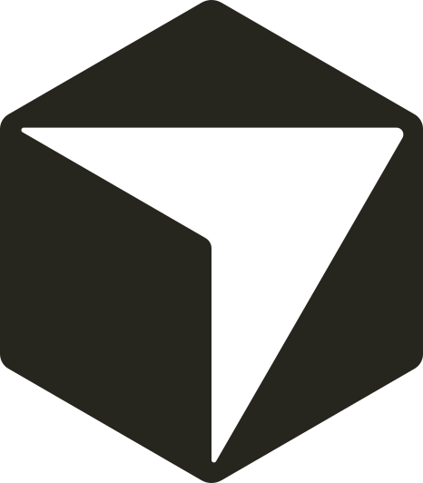
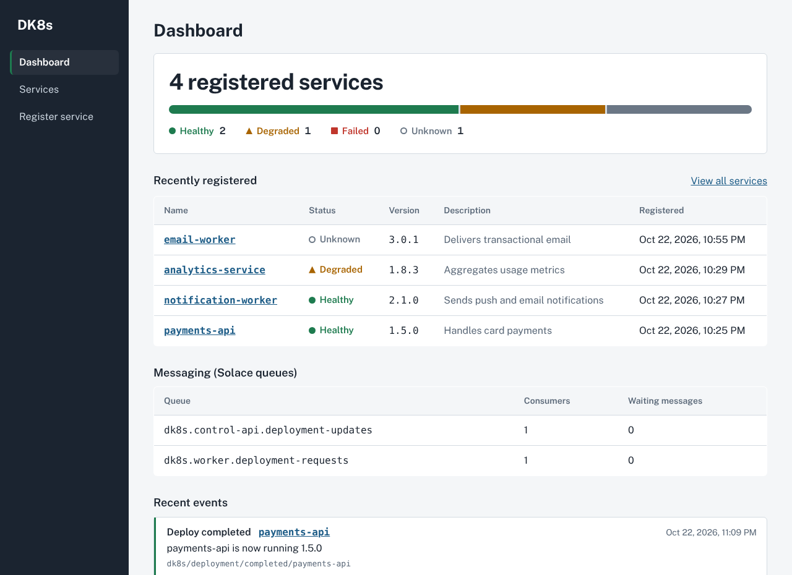
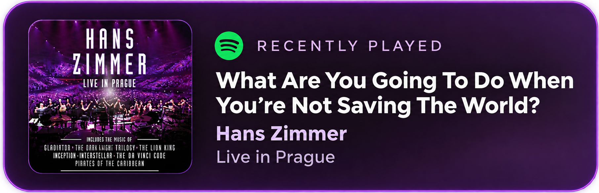

<h1 align="center">
  &nbsp; Daniel Khojaste
</h1>

<h3 align="center"><big>Full-Stack Software Developer</big></h3>

I turn ideas into polished, working software, from the first screen to the final deploy.

[LinkedIn](https://www.linkedin.com/in/aref-khojaste/) &nbsp;&nbsp; [GitHub](https://github.com/DanielKhojaste) &nbsp;&nbsp; [Email](mailto:danielkhojaste101@gmail.com)

 

## Give me your stack. Give me a challenge.

**A resume makes me look just like everyone else.** Give me a **stack** and a **challenge**, and I'll show you why I **stand out**.

Send me your **tech stack**, a **scoped problem**, and what you want to see.  
Give me up to a week and I will turn it into something real your tech lead can review.

🟪 **Design** interfaces and prototypes in Figma  
🟪 **Build** clean software across the stack  
🟪 **Test** critical flows with automation  
🟪 **Document** from setup to handoff  
🟣 **Launch** a live project you can review

**AI-assisted or fully manual, your call.** I'm more than happy to build without AI, and I'm comfortable coding live in an interview.

**You have nothing to lose! 🙂** Sending me your stack takes less than a minute, probably even less time than reading my resume! You either find exactly who you're looking for, or you save some time and I get another cool project on my GitHub. It's a win-win, isn't it? 😎

## About me

I'm a graduate of Algonquin College's **Web Development & Internet Applications** program, where I made the **Dean's Honours List** three times. I work across frontend, backend, REST APIs, databases, testing, and deployment, and I learn new technologies quickly by putting them to work.

## Skills

<table align="center">
	<tr>
		<th align="left">Area</th>
		<th align="left">Technologies</th>
	</tr>
	<tr>
		<td align="left" valign="middle"><strong>Languages</strong></td>
		<td align="left" valign="middle"></td>
	</tr>
	<tr>
		<td align="left" valign="middle"><strong>Frontend &amp; Design</strong></td>
		<td align="left" valign="middle"></td>
	</tr>
	<tr>
		<td align="left" valign="middle"><strong>Backend &amp; Data</strong></td>
		<td align="left" valign="middle">&nbsp;&nbsp;&nbsp;&nbsp;&nbsp;&nbsp;&nbsp;&nbsp;</td>
	</tr>
	<tr>
		<td align="left" valign="middle"><strong>Application Frameworks</strong></td>
		<td align="left" valign="middle">&nbsp;&nbsp;</td>
	</tr>
	<tr>
		<td align="left" valign="middle"><strong>Testing &amp; Tools</strong></td>
		<td align="left" valign="middle">&nbsp;&nbsp;</td>
	</tr>
	<tr>
		<td align="left" valign="middle"><strong>AI Development</strong></td>
		<td align="left" valign="middle">&nbsp;&nbsp;&nbsp;&nbsp;<picture><source media="(prefers-color-scheme: dark)" srcset="./assets/cursor-dark.svg" /></picture>&nbsp;&nbsp;<picture><source media="(prefers-color-scheme: dark)" srcset="./assets/github-copilot-dark.svg" /></picture></td>
	</tr>
</table>

## Featured projects

### [DK8s](https://github.com/DanielKhojaste/dk8s)

	
	
	
	
	
	
	

An event-driven engineering operations console for registering, monitoring, and managing service lifecycles, with asynchronous deployment workflows powered by Solace PubSub+.

### [ApotheonAI](https://apotheon-ai.vercel.app/)

	
	
	
	
	
	
	

A multi-page AI security website built around reusable frontend components, responsive and accessible UI, structured CMS content, dynamic routes, and browser-based end-to-end testing.

### [ToDone for VS Code](https://marketplace.visualstudio.com/items?itemName=danielkhojaste.todone-vscode)

	
	

A VS Code extension that brings the ToDone plain-text task workflow to VS Code with priorities, task states, notes, commands, outline support, and Sublime ToDone compatibility.

<h3 align="center">
  <a href="./PROJECTS.md"><strong>View All Projects →</strong></a>
</h3>

## How I like to work

🟨 **Build** end to end.

🟨 **Design** with intent.

🟨 **Test** what matters.

🟨 **Document** as I go.

🟡 **Own** the result.

 

  
    
  <i>Click the card to listen on Spotify</i>

## Get in touch

I'm based in Canada and I'm willing to relocate. If you have a stack or a challenge in mind, send it my way, and I'll get back to you within **7 days**!

[Email](mailto:danielkhojaste101@gmail.com) &nbsp;&nbsp; [LinkedIn](https://www.linkedin.com/in/aref-khojaste/) &nbsp;&nbsp; [GitHub](https://github.com/DanielKhojaste)

**Name the stack.**  
**Set the challenge.**  
**See it happen.**

